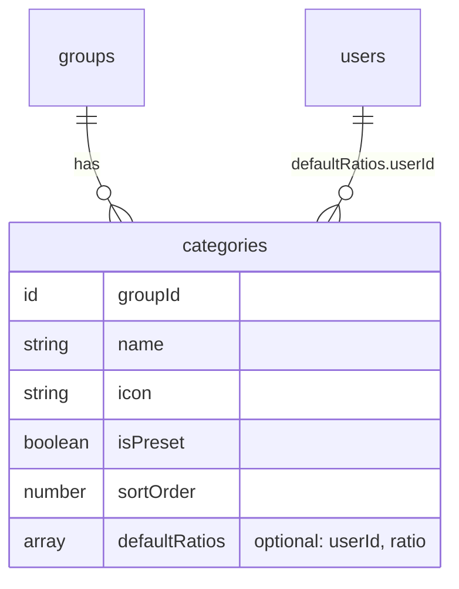
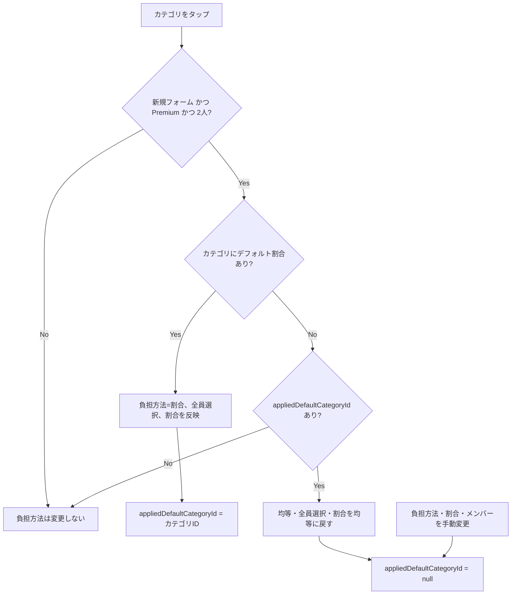

# Overview

2人グループで、カテゴリごとに「いつもの負担割合」を設定できるようにする。設定はカテゴリを一覧したスライダー画面で行う。設定済みのカテゴリを支出の新規記録で選ぶと、負担方法が自動で「割合」になり、設定した割合が入力済みになる。

```
例: 食費 = 60:40、住居費 = 70:30、日用品 = 未設定（均等）

[支出を記録]
金額 ¥3,000 → カテゴリ「食費」をタップ
  → 負担方法: 割合（あなた 60% / パートナー 40%）が自動入力
  → 「食費の割合を適用中」と表示
  → 記録する
```

## Purpose

- ユーザー要望:「我が家ではカテゴリで割合を決めているので、デフォルト値を設定したい」
- 現状、割合指定は毎回「割合」タブを押して数値を入力し直す必要がある（初期値は常に均等）
- カテゴリで割合が決まっている家庭では、毎回同じ入力を繰り返しており、UX指針「3タップ以内で記録完了」に反する
- 傾斜折半はPremium機能であり、その中心ユーザー（毎回割合を入れている人）の手間を減らすことでPremiumの価値を高める

## What to Do

### 機能要件

1. **設定画面（カテゴリ別の負担割合）**
   - 全カテゴリを並べ、各行に割合のスライダーを常時表示する（タップして開く操作は不要）
   - スライダーの左側が1人目、右側が2人目の取り分。トラックをメンバーカラーで塗り分ける
   - 中央（50:50）= 未設定（均等と同じ結果）。中央に目盛りを表示する
   - 5%刻み。指を離した時点で自動保存（保存ボタンなし）
   - 行の右側に `60:40` 形式で表示する（未設定は `50:50` を薄い色で表示）
2. **入口**
   - グループ設定の「分類」セクションに「カテゴリ別の負担割合」行を追加する（定期支出・タグと同じ形式）
   - 支出フォームで「割合」を選んでいるとき、負担方法の見出し横に「カテゴリごとに保存できます ›」を表示し、同じ設定画面を開く
3. **支出フォームへの反映**
   - 対象: 支出の新規記録、定期支出テンプレートの新規作成（`initialData` なしで開いたフォーム）
   - カテゴリを選んだとき、そのカテゴリにデフォルト割合があれば負担方法を「割合」にして値を入れる
   - フォームを開いた時点の初期カテゴリ（`categories[0]`）にも反映する
   - 反映中は負担方法欄に「{カテゴリ名}の割合を適用中」と表示する
   - 反映後に手で変えた値はその支出だけに使う（デフォルトは書き換えない）
4. **対象グループ**
   - 2人グループのみ。1本のスライダーで表せるのが2人分の割合のため
   - Premiumグループのみ設定可能（サーバー側でも検証）。Freeグループでは設定行に「Premiumプラン限定」と表示する
   - Premiumが切れた、またはメンバーが3人以上になったグループでは、保存値を残したまま反映しない

### 反映ルール

| ケース                                                     | 挙動                                   |
| ---------------------------------------------------------- | -------------------------------------- |
| 新規フォームを開いた時点の初期カテゴリにデフォルトあり     | 初期状態から割合を反映                 |
| デフォルトありのカテゴリをタップ                           | 割合を反映（手動変更していても上書き） |
| デフォルトなしのカテゴリをタップ、直前はデフォルト反映中   | 均等（全員）に戻す                     |
| デフォルトなしのカテゴリをタップ、反映後に手動変更している | 何もしない（手動の値を維持）           |
| 編集・複製で開いたフォーム                                 | 反映しない（保存済みの値を維持）       |
| グループが非Premium、またはメンバーが2人でない             | 反映しない                             |

「デフォルトありのカテゴリをタップしたら手動変更も上書き」とするのは、フォームの並びがカテゴリ → 負担方法の順で、カテゴリを選び直した場合はそのカテゴリの設定を使いたいケースが大半と判断したため。

### バリデーション（サーバー）

| ルール                                  | エラー時                                        |
| --------------------------------------- | ----------------------------------------------- |
| 設定時はグループがPremium（解除は不要） | 傾斜折半機能はPremiumプランでご利用いただけます |
| 各 userId がグループメンバー            | 割合の対象メンバーがグループに所属していません  |
| userId の重複なし                       | 同じメンバーの割合が重複しています              |
| 各値が0〜100の整数、合計100             | 既存 `validateRatioSplit` のメッセージ          |
| 空配列は不可（解除は `null`）           | 割合が指定されていません                        |

サーバー側は人数を制限しない（N人の割合も保存できる）。2人限定はUIの制約とし、ドメインルールは支出の割合指定と揃える。

### 非機能要件

- 設定済みカテゴリの記録は「金額 → カテゴリ → 記録する」で完了（割合入力の追加タップ0）
- 既存データへの影響なし（optional フィールドの追加のみ、マイグレーション不要）

## How to Do It

### データ構造

`categories` に optional フィールド `defaultRatios` を追加する。未設定（フィールドなし）= デフォルトなし（均等）。



```typescript
// convex/lib/validators.ts
// splitDetailsValidator の ratio と共用する
export const ratiosValidator = v.array(
  v.object({ userId: v.id("users"), ratio: v.number() }),
);

// convex/schema.ts
categories: defineTable({
  // ...既存フィールド
  defaultRatios: v.optional(ratiosValidator),
}).index("by_group", ["groupId"]),
```

### ドメイン層

`convex/domain/category/rules.ts` に追加する。比率自体の検証は既存の `validateRatioSplit` を再利用する。

```typescript
export function validateDefaultRatios(
  ratios: RatioSplitInput[],
  groupMemberIds: Id<"users">[],
): void;
// 重複チェック → メンバー所属チェック → validateRatioSplit(ratios, ratios.map((r) => r.userId))
```

### API

| 関数                          | 変更                                                                                  |
| ----------------------------- | ------------------------------------------------------------------------------------- |
| `categories.setDefaultRatios` | 新規。`{ categoryId, ratios: ratiosValidator \| null }`。`null` で解除                |
| `groups.getDetail`            | 変更なし（カテゴリのドキュメントをそのまま返しているため `defaultRatios` も含まれる） |

- 配列を指定した場合のみ `canUseSlopedSplit(ctx, groupId)` と `validateDefaultRatios` を実行する
- 監査ログ `default_ratios_updated`（`hasDefaultRatios`）を出す
- スライダーは1行ずつ自動保存するため、カテゴリ単位の専用 mutation にする。`categories.update` は変更しない

### フロントエンド



`appliedDefaultCategoryId`（デフォルトを反映して以降、手動変更されていないカテゴリのID）1つで、「適用中」表示と「デフォルトなしカテゴリへの切替時に戻すか」の判定を兼ねる。

| ファイル                                           | 変更内容                                                                                                                      |
| -------------------------------------------------- | ----------------------------------------------------------------------------------------------------------------------------- |
| `lib/splitRatios.ts`（新規）                       | `equalRatioMap` / `toRatioMap` / `firstPairRatio` / `toPairRatios`（50:50 は `null`）。ExpenseForm 内の均等割合計算も置き換え |
| `components/categories/CategoryRatioManager.tsx`   | 新規。スライダー一覧ダイアログ。トリガー要素を `children` で受け取り、設定画面と支出フォームの両方から開く                    |
| `components/groups/GroupSettings.tsx`              | 「カテゴリ別の負担割合」行を追加（2人グループのみ。Freeは「Premiumプラン限定」表示）                                          |
| `components/expenses/ExpenseForm.tsx`              | 上記フローの実装、初期 state への反映、「適用中」表示、「カテゴリごとに保存できます ›」リンク                                 |
| `components/expenses/ExpenseCreateModal.tsx`       | `useGroupPremium` の `isLoading` 中はスケルトン表示（初期 state 計算時に `isPremium` を確定させるため）                       |
| `app/(app)/groups/[groupId]/expenses/new/page.tsx` | 同上                                                                                                                          |

スライダーは `radix-ui` の Slider を使う（既存依存、追加なし）。保存中に値が戻らないよう、操作中の値をローカルの `drafts` に持ち、mutation 完了で破棄する（Convex は mutation 完了時点でクエリ結果に反映済み）。

`ExpenseForm` の `useState` 初期化は初回のみ評価されるため、`isPremium` が後から `true` になっても初期カテゴリのデフォルトは反映されない。呼び出し側でPremium判定のロード完了を待ってからフォームを描画する。`RecurringExpenseManager` は `isPremium` を固定で渡しているため対応不要。

### UI

```
[グループ設定 > 分類]                     [カテゴリ別の負担割合]
┌───────────────────────────────────┐   ┌──────────────────────────────┐
│ 🏷 カテゴリ  13個      [カテゴリ管理] │   │ ● たろう          はなこ ●   │
│ ⇆ カテゴリ別の負担割合               │   │ 🛒 食費            60:40   │
│   2個のカテゴリに設定中  [負担割合]  │   │ ━━━━━━━━━━━━━━●─────────── │
│ 🏷 タグ                  [タグ管理]  │   │ 🍽 外食             50:50   │
└───────────────────────────────────┘   │ ━━━━━━━━━━━●────────────── │
                                        │ 🏠 住居費          70:30   │
[支出を記録] 割合を選択中                │ ━━━━━━━━━━━━━━━━━●──────── │
負担方法   カテゴリごとに保存できます ›  └──────────────────────────────┘
[均等][割合][金額][全額]                  左=1人目の取り分・中央=50:50・5%刻み
```

### テスト

| 対象                                | ケース                                                                                                    |
| ----------------------------------- | --------------------------------------------------------------------------------------------------------- |
| `categoryRules.test.ts`             | 正常、一部メンバーのみ、合計≠100、範囲外、非整数、重複、非メンバー、空配列                                |
| `categories.test.ts`                | 設定・解除（Premium）、カテゴリ更新で維持、Freeで設定は拒否、Freeでも解除は可、非メンバーの操作・IDは拒否 |
| `lib/__tests__/splitRatios.test.ts` | 均等割合の端数、全メンバー分の Map、`firstPairRatio` の未設定、`toPairRatios` の 50:50 = `null`           |

### シードデータ

更新しない。テストグループは開発者が `seed:joinTestGroup` で参加すると3人になり、この機能の対象外になるため。

### リリースノート

`lib/releases.ts` に追加する。

- タイトル: カテゴリごとに負担割合を設定できるようになりました（Premium）
- 本文: 2人グループで、カテゴリごとにいつもの負担割合をスライダーで登録できるようになりました。グループ設定の「カテゴリ別の負担割合」から設定できます。支出を記録するときにカテゴリを選ぶだけで、登録した割合が自動で入力されます。

## What We Won't Do

| 項目                                                   | 理由                                                                  |
| ------------------------------------------------------ | --------------------------------------------------------------------- |
| 3人以上のグループ                                      | スライダーで表せない。ターゲットはカップルで、UIを2種類持つ価値が低い |
| 割合以外のデフォルト（全額・金額・一部メンバーの均等） | 要望は割合。全額は「支払った人が全額」など意味が分かれ、仕様が膨らむ  |
| 1%刻みの設定                                           | スマホで指が合わない。端数の割合は支出ごとの入力で調整できる          |
| 明示的な 50:50 のデフォルト                            | 均等と結果が同じ。中央=未設定とすることでスイッチが不要になる         |
| 編集・複製時の反映                                     | 保存済みの値をユーザーの意図なく書き換えるリスクがある                |
| グループ全体のデフォルト割合                           | カテゴリ単位で足りる                                                  |
| 既存支出への一括適用                                   | 過去の精算結果が変わるため行わない                                    |
| 料金ページ・LPへの追記                                 | 本機能単体では売りとして弱い。傾斜折半の説明の範囲に含める            |

## Alternatives Considered

| 案                                            | 概要                                 | 不採用の理由                                                                                  |
| --------------------------------------------- | ------------------------------------ | --------------------------------------------------------------------------------------------- |
| カテゴリ編集画面にスイッチと割合入力を追加    | カテゴリ管理 → 編集 の中で設定       | 一度実装したが、入口が深くユーザーが辿り着けない。カテゴリを一覧しながら設定できない          |
| 一覧で行をタップすると入力欄が開く            | 3人以上にも同じUIで対応できる        | 1タップ余分にかかる。一覧のまま設定したい                                                     |
| `defaultSplit: SplitDetails` として保存       | 将来の全額・均等にも対応できる汎用形 | 今回は割合のみ。使わない分岐を持つと検証とUIが複雑になる。必要になった時点で移行可能          |
| 別テーブル `categorySplitDefaults`            | カテゴリと1:1の設定テーブル          | カテゴリ取得時に追加クエリが要る。1:1 の optional 値はカテゴリに持たせる方が単純              |
| `categories.update` に `defaultRatios` を追加 | 名前・アイコンと一緒に保存           | スライダーの自動保存に名前・アイコンは不要。旧クライアントの更新で消えないよう3値が必要になる |
| カテゴリ切替のたびに常に均等へ戻す            | ロジックが最も単純                   | デフォルトを使わないグループでも、カテゴリを選び直すと負担方法がリセットされる挙動変更になる  |
| ユーザー単位のデフォルト                      | 個人ごとに設定                       | 割合は「我が家」の取り決めでグループ共有が自然。メンバー間で結果がずれる                      |

## Concerns

| 懸念                                               | 対応                                                                                        |
| -------------------------------------------------- | ------------------------------------------------------------------------------------------- |
| 自動で負担方法が変わったことに気付かない           | 「{カテゴリ名}の割合を適用中」を負担方法の見出し横に表示。割合入力欄も開いた状態になる      |
| Premium判定待ちで新規フォームの表示が遅れる        | `getGroupPremium` は軽量クエリ。モーダル・ページとも既存スケルトンを流用し、体感差は小さい  |
| 支出フォームのモーダルの上に設定ダイアログが重なる | Radix Dialog はポータルで最前面に出る。Escape は Radix 側で止まるため支出フォームは閉じない |
| 保存中に続けてスライダーを動かす                   | 先の保存完了で一時的に保存値へ戻り、次の保存で追いつく。致命的ではないため許容              |
| メンバーが3人以上になった後の古い設定              | 反映しない。設定画面も出ないため解除はできないが、データが残っても影響はない                |
| カテゴリ削除時                                     | カテゴリと一緒に消えるため追加対応不要                                                      |

## Reference Materials/Information

- 負担方法の設計: `docs/design-split-methods.md`
- 一部メンバー選択の設計: `docs/design-partial-member-split.md`
- ペアプラン（グループ単位Premium）: `docs/design-pair-plan.md`
- 割合のバリデーション: `convex/domain/expense/rules.ts` (`validateRatioSplit`)
- Premium判定: `convex/lib/subscription.ts` (`canUseSlopedSplit`)
- 支出フォーム: `components/expenses/ExpenseForm.tsx`
- 設定画面: `components/groups/GroupSettings.tsx`
