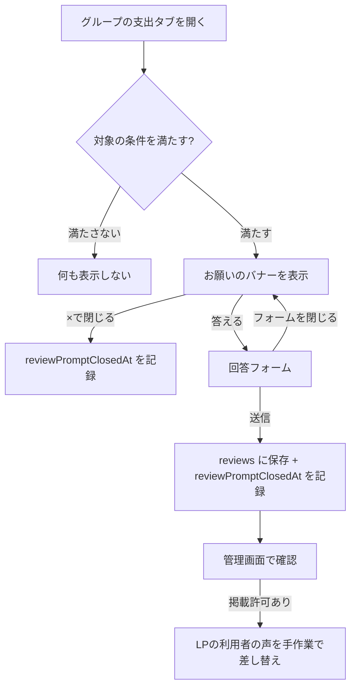
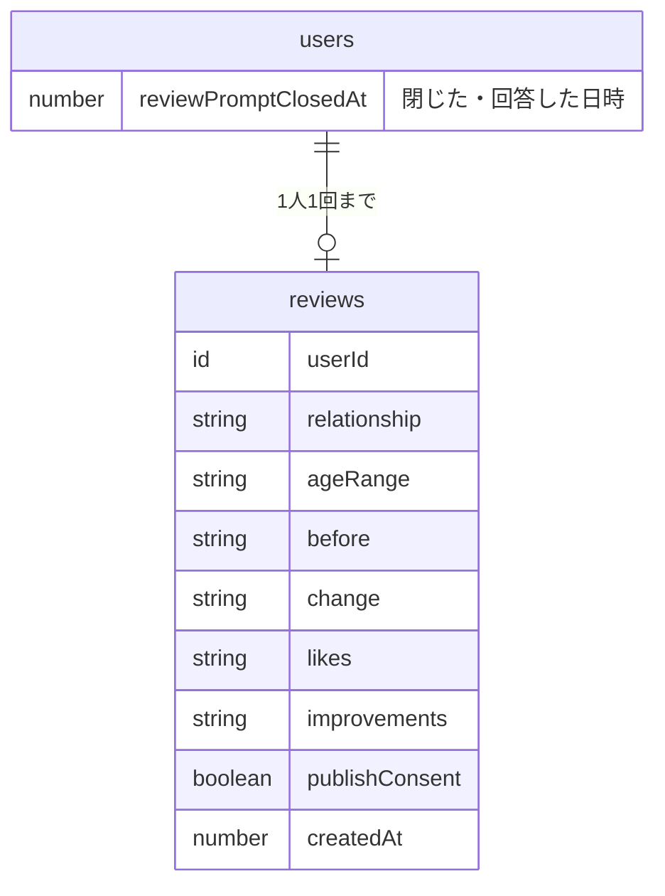

# Overview

しばらく使い続けているふたり組の利用者に、アプリ内で一度だけ感想を頼む。掲載の許可をもらえた感想を、LPの「こんなシーンで活躍」にある架空の声と置き換える。

## Purpose

LPの「こんなシーンで活躍」に並んでいる3つの声は、2026年2月に用意した架空の文章で、実際の利用者の声ではない。利用者の声は、LPを見た人が登録するかどうかを判断する材料になる。そのため、本物の声に置き換えたい。架空の声を利用者の声のように見せ続けると、信頼を損なうおそれもある。

Googleの順位を上げる効果はない。自社サイトに載せた口コミの星は検索結果に表示されず、口コミが効くのはLPを見た人の登録率のほう。共同財布ガイドページ（v1.12.0）で増やした検索からの流入を、登録につなげる役割を持つ。

頼める相手は多くない。2026年10月7日時点の本番データでは、ふたりで使っていて最近30日以内に記録があるグループのうち、下の条件を満たすのは18グループ（約36人）だった。人数が少ないので、何人に頼むかより、1件ずつLPで使える具体的な感想を引き出せるかが大事になる。

| 条件                   | グループ数 |
| ---------------------- | ---------: |
| 90日以上・支出50件以上 |         13 |
| 60日以上・支出30件以上 |         16 |
| 30日以上・支出30件以上 |         18 |
| 30日以上・支出15件以上 |         24 |

## What to Do

### 機能要件

#### 頼む相手

次の条件をすべて満たすグループのメンバーに、支出タブの上部にお願いのバナーを出す。

- メンバーが2人以上いる
- 2人目のメンバーが参加してから30日以上たっている（月ごとの精算を1回は経験している）
- 支出が30件以上ある
- 本人がまだバナーを閉じておらず、回答もしていない

条件はグループを開くたびに判定する。今は外れるグループも、使い続ければ後から対象に入る。バナーはユーザー単位で一度だけ出す。閉じるか回答すると、どのグループでも二度と出ない。

#### バナー

- 文言: 「Pairboの感想を聞かせてください」「1分ほどで終わります」
- 「答える」ボタンで回答フォームを開く
- ×ボタンで閉じる。閉じたら二度と出さない
- 自動で開くダイアログにはしない（理由は「Alternatives Considered」）

#### 回答フォーム

| #   | 設問                                                   | 形式                                 | 必須 |
| --- | ------------------------------------------------------ | ------------------------------------ | ---- |
| 1   | ふたりの関係                                           | 選択（同棲カップル / 夫婦 / その他） | 必須 |
| 2   | 年代                                                   | 選択（20代 / 30代 / 40代以上）       | 任意 |
| 3   | Pairboを使う前は、ふたりのお金をどう分けていましたか？ | 自由記述                             | 必須 |
| 4   | Pairboを使って、何が変わりましたか？                   | 自由記述                             | 必須 |
| 5   | Pairboの気に入っているところ                           | 自由記述                             | 任意 |
| 6   | 改善してほしいところ                                   | 自由記述                             | 任意 |
| 7   | 回答をPairboのWebサイトに掲載してもよい                | チェックボックス（初期値はオフ）     | 任意 |

設問の意図は次のとおり。

- 3と4: 使う前と使った後の変化を聞いて、LPの「お悩み → 解決」の流れにそのまま使える具体的な声を集める。「感想を教えてください」とだけ聞くと、「便利です」のような使いにくい答えになりやすい
- 5: どの機能や使い勝手が気に入られているかを知り、LPで前に出す機能を決める材料にする
- 6: 任意にして、良いことだけ書かなくていい雰囲気を作る。製品改善の材料にもなる
- 1と2: 掲載するときの表示（「同棲カップル（20代）」の形式）に使う。名前は聞かない
- 7: 掲載の許可。チェック欄の下に「名前は載せません。意味を変えない範囲で文章を短くすることがあります。掲載をやめたい場合は、お問い合わせからご連絡ください。」と添える

送信後は「ありがとうございました。いただいた感想は、Pairboの改善に役立てます。」と表示する。

#### 管理画面

既存の管理画面（`/admin`）の一番下に「感想一覧」の表を追加し、全件を新しい順に表示する。ユーザー一覧と同じく1件1行・10件ごとのページ送りにする。回答は省略して表示し、全文はマウスを重ねて読む。掲載許可の有無が一目で分かるようにする。件数が少ないので、期間で絞らない。

#### LPの架空の声

本物の声が集まるまでの間、今の架空の声を利用者の声と誤解されないようにする。「こんなシーンで活躍」の説明文の下に「※ 利用シーンをイメージした例です」と添える。セクションごと外す案もあったが、利用シーンの説明としては役に立っているので残す。掲載許可付きの感想が集まったら、本物の声に差し替えて注記を外す。

#### プライバシーポリシー

回答を集めて掲載するので、プライバシーポリシーを更新する。

- 「収集する情報」に「アンケートの回答（感想・ご意見）」を追加
- 「情報の利用目的」に「ご同意いただいたアンケート回答の、当サービスのWebサイトへの掲載（氏名は掲載しません）」を追加
- 最終更新日を更新

### 非機能要件

- 支出の記録を邪魔しない。入力UXを最優先にする方針に合わせ、バナーは記録の操作をさえぎらない位置に置く
- 対象かどうかの判定は軽くする。支出は30件まで数えれば足りるので、全件は読まない
- 自由記述は各1,000文字まで。回答はユーザー1人につき1回まで

## How to Do It

### 全体の流れ



フォームを送らずに閉じた場合は、バナーを残す。閉じたことにするのは、バナーの×を押したときだけにする。

### データ構造

`users` に、バナーを閉じた（または回答した）日時を追加する。

```ts
users: defineTable({
  // ...既存のフィールド
  reviewPromptClosedAt: v.optional(v.number()),
});
```

回答を保存するテーブル `reviews` を追加する。

```ts
reviews: defineTable({
  userId: v.id("users"),
  relationship: reviewRelationshipValidator, // "cohabiting" | "married" | "other"
  ageRange: v.optional(reviewAgeRangeValidator), // "20s" | "30s" | "40s_plus"
  before: v.string(), // 使う前のお金の分け方
  change: v.string(), // 使って変わったこと
  likes: v.optional(v.string()), // 気に入っているところ
  improvements: v.optional(v.string()), // 改善してほしいところ
  publishConsent: v.boolean(),
  createdAt: v.number(),
}).index("by_user", ["userId"]);
// 用途: 1人1回の重複チェック
```



### 変更対象

| ファイル                                    | 変更内容                                                                                     |
| ------------------------------------------- | -------------------------------------------------------------------------------------------- |
| `convex/schema.ts`                          | `users.reviewPromptClosedAt` と `reviews` テーブルを追加                                     |
| `convex/lib/validators.ts`                  | `reviewRelationshipValidator`・`reviewAgeRangeValidator` を追加                              |
| `convex/domain/review/`                     | 新規。対象判定（`isReviewPromptEligible`）と入力チェックのルールを、DBに依存しない関数で書く |
| `convex/reviews.ts`                         | 新規。`shouldShowPrompt`（query）、`closePrompt`・`submit`（mutation）                       |
| `convex/admin.ts`                           | `getReviews`（管理者用の一覧）を追加                                                         |
| `components/reviews/ReviewPromptBanner.tsx` | 新規。お願いのバナー                                                                         |
| `components/reviews/ReviewDialog.tsx`       | 新規。回答フォーム。閉じても書きかけの内容を残す                                             |
| `components/groups/GroupDetail.tsx`         | 支出タブ上部の既存バナーの並びに `ReviewPromptBanner` を追加                                 |
| `app/(app)/admin/page.tsx`                  | 「感想一覧」の表を追加                                                                       |
| `app/(marketing)/privacy/page.tsx`          | 収集する情報・利用目的・最終更新日を更新                                                     |
| `components/landing/LandingPage.tsx`        | 「こんなシーンで活躍」に、利用シーンの例であることの注記を追加                               |
| `convex/seed.ts`                            | ローカル確認用に、テスト用グループを対象条件に合わせる内部関数を追加                         |
| `convex/__tests__/`                         | `reviewRules.test.ts`・`reviews.test.ts` を追加                                              |

### サーバー側の処理

`shouldShowPrompt({ groupId })` は、次の順に判定して `boolean` を返す。

1. `ctx.user.reviewPromptClosedAt` があれば `false`
2. グループのメンバーでなければ `false`。補助的なバナーなので、グループの削除や脱退の直後に画面ごとエラーにならないよう、エラーにはしない
3. メンバーの `joinedAt` を古い順に並べ、2番目が30日以上前でなければ `false`
4. `expenses` を `by_group_and_date` インデックスで `take(30)` し、30件に届かなければ `false`

条件の数値（30日・30件）は `convex/domain/review/rules.ts` の定数にまとめる。

`submit` は入力をチェックしてから `reviews` に保存し、同じトランザクションで `reviewPromptClosedAt` を記録する。すでに回答があるユーザーからの送信はエラーにする。`closePrompt` は `reviewPromptClosedAt` を記録するだけで、何度呼んでも結果は同じ。

### 計測

GA4に次のイベントを送る。お問い合わせや招待リマインダーと同じく `trackEvent` を使う。

| イベント                  | タイミング                                      |
| ------------------------- | ----------------------------------------------- |
| `review_prompt_shown`     | バナーを表示したとき                            |
| `review_prompt_opened`    | 「答える」を押したとき                          |
| `review_prompt_dismissed` | ×で閉じたとき                                   |
| `submit_review`           | 送信に成功したとき（`publishConsent` を付ける） |

回答数と掲載許可の数は、管理画面で確認する。公開から4週間で、掲載許可付きの感想が3件以上集まれば、LPの3つの声をすべて差し替えられる。集まりが悪い場合は、お礼の追加や条件の緩和を検討する。

### ローカルでの確認方法

シードデータのテスト用グループは、メンバーの参加日が実行時点で、支出も12件しかないので、そのままでは対象にならない。テスト用グループを対象条件に合わせる内部関数 `seed:makeReviewPromptEligible` を追加する。2人目の参加日を31日前にずらし、支出を30件以上に増やし、シードユーザーの `reviewPromptClosedAt` を消す。バナーを何度でも出し直せるので、動作確認がしやすい。

## What We Won't Do

- LPの利用者の声の自動表示。集まった感想は管理画面で読み、選んでから `LandingPage.tsx` を手作業で書き換える。件数が少なく、文章を短くする作業も必要なため
- お礼の付与（Premiumの無料期間など）。まずはお礼なしで反応を見て、4週間後の結果で再検討する。既存のトライアル付与（`claimTrial`）は1人1回までで、対象の多くは招待のときにすでに使っているので、お礼を付けるなら別の仕組みが必要になる
- リリースノートへの追加。バナーは条件を満たした人にしか出ないので、全員に届くリリースノートで告知すると、出ない人を混乱させる
- メールやプッシュ通知でのお願い。通知機能はMVPの範囲外
- 回答の編集・削除の画面。掲載の取り下げはお問い合わせで受け付け、管理者が対応する

## Alternatives Considered

| 案                                           | 概要                                                          | 不採用の理由                                                                                                                                                               |
| -------------------------------------------- | ------------------------------------------------------------- | -------------------------------------------------------------------------------------------------------------------------------------------------------------------------- |
| グループを開いたときに自動でダイアログを出す | 招待リマインダーと同じく、モーダルで表示する                  | 支出を記録しようと開いた瞬間に割り込む。対象は特によく使っている人たちで、記録の邪魔をしたくない。バナーなら閉じるまで毎回目に入るので、何度か目にするうちに答えてもらえる |
| お問い合わせフォームを流用する               | `inquiries` にカテゴリ「感想」を足し、自由記述1つで受け付ける | 設問ごとに分けて聞けない。掲載許可や表示用の属性（関係・年代）も保存できない                                                                                               |
| 外部フォーム（Googleフォームなど）に誘導する | アプリの外で回答を集める                                      | 実装は不要だが、回答とユーザーを結びつけられず、1人1回の制御もできない。アプリを離れるので回答率も下がる                                                                   |
| 条件を設けず全員に頼む                       | 登録しているユーザー全員にバナーを出す                        | 始めたばかりの人は感想を書きにくく、LPで使える声になりにくい。条件で外れる人も、使い続ければ後から対象に入る                                                               |

## Concerns

- **回答が集まらない可能性**: 対象は約36人で、何件集まるかは分からない。4週間たっても掲載許可付きの感想が3件に届かなければ、お礼の追加や条件の緩和を検討する
- **自分たちのグループも対象になる**: 開発者自身のグループも条件を満たすので、バナーが出たら閉じる
- **ふたりの両方が答える場合**: 同じグループの2人から別々に回答が来ることがある。視点が違う声として、どちらも掲載候補にする

## Reference Materials/Information

- 本番データの集計（2026-10-07）: Convexの読み取り専用クエリで、ふたりで使っているグループの利用期間・支出数・最終記録日を集計
- 既存のお問い合わせ: `convex/inquiries.ts`、`components/inquiries/InquiryDialog.tsx`
- 既存のバナー・ダイアログ: `components/ui/TrialRemainingBanner.tsx`、`components/groups/InviteCtaBanner.tsx`、`components/groups/InviteReminderModal.tsx`
- 招待報酬トライアル: `docs/design-invite-reward-trial.md`
- 共同財布ガイドページ: `docs/design-guide-shared-wallet.md`
